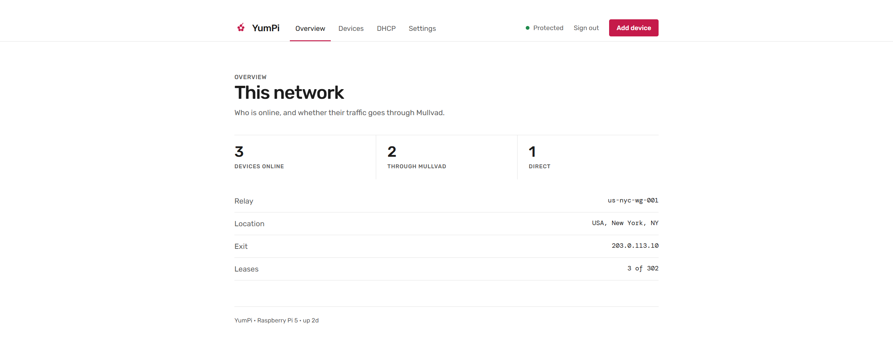
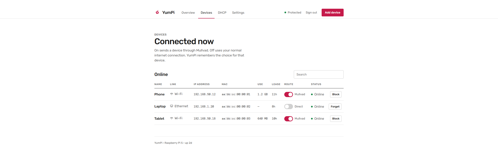
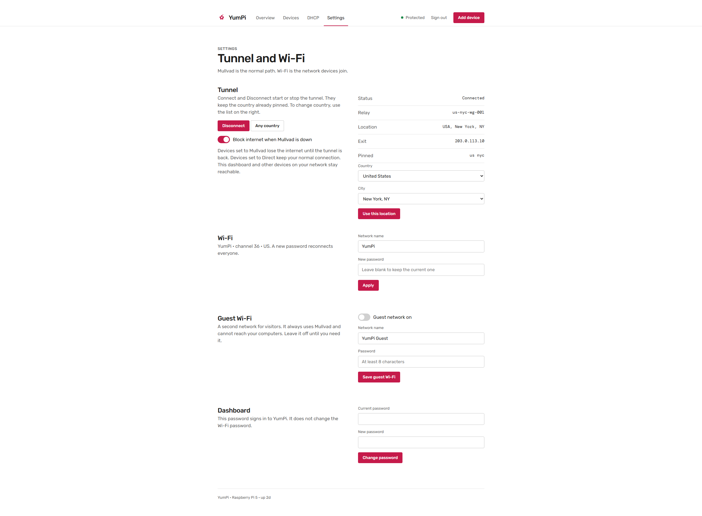

<p align="center">
  
</p>

<h1 align="center">YumPi</h1>

<p align="center">A Raspberry Pi gateway that puts the network on Mullvad.</p>

YumPi runs a Wi-Fi access point, hands out addresses, and sends client traffic through a Mullvad tunnel. One dashboard shows who is online and lets any single device take the direct path instead. The rest of the network stays on the tunnel.

The control plane is one Go program in a container. The Pi keeps Docker, the Mullvad daemon, and IP forwarding. The container runs hostapd, dnsmasq, and the firewall.

## Dashboard

The dashboard is on the Pi at `https://<pi>:8443`. If the tunnel drops, YumPi brings it back. Disconnect is the one choice that stays off. These pictures use example devices.







## What it does

- The installer reads the wired network already on the Pi and asks before it saves it. Wi-Fi uses a separate subnet that does not overlap that network. Wired clients that lease from the Pi use the Pi as their gateway.
- Lookups go to Mullvad DNS (`10.64.0.1`), so they follow the tunnel.
- A device set to direct keeps that choice by its MAC, and its DNS goes to `1.1.1.1`.
- If the tunnel drops, YumPi brings it back. Disconnect is the one choice that stays off. While it is down, clients use the direct path, or pause if that setting is on. A device set to direct keeps that path.
- Guest Wi-Fi can be turned on later. Guests stay on Mullvad and cannot reach the LAN or the dashboard.
- The dashboard is HTTPS only, at `https://<pi>:8443`. Trust the Pi’s certificate once. Do not forward that port from the internet. The sign-in password can be changed in Settings.

## Install

The image is [`ghcr.io/elvonpiko/yumpi:v0.1.0`](https://github.com/elvonpiko/yumpi/pkgs/container/yumpi). `latest` tracks the newest release. The image is built for a 64-bit Raspberry Pi.

On Raspberry Pi OS or Debian, with ethernet and a working internet connection, copy this repository onto the Pi and run:

```sh
sudo ./install.sh
```

The script installs Docker and Mullvad when they are missing, pulls the image, and starts the container. It finds the wired address and gateway, suggests a Wi-Fi subnet that does not overlap them, and asks you to confirm. It also asks for a Wi-Fi name and two passwords, or generates them and prints them once. A second run keeps `/etc/yumpi/config.toml`.

To move a Pi that is already running onto this release:

```sh
docker pull ghcr.io/elvonpiko/yumpi:v0.1.0
docker compose up -d --force-recreate --no-build
```

Run that from the directory that holds `compose.yml`. The container keeps `/etc/yumpi` and `/var/lib/yumpi`, so the Wi-Fi password, dashboard login, and device choices stay.

After it finishes:

1. Log the host into Mullvad once: `mullvad account login`. The installer never sees the account.
2. Join the Wi-Fi it printed and confirm a client has internet.
3. Keep the wired address the installer found. If the upstream router still hands out addresses, give the Pi a fixed address on that same network and turn the router's DHCP off when the Pi should own the wired LAN. Leave the router itself on. Wired computers should reconnect so they take an address from the Pi.

These variables skip the prompts:

- `YUMPI_SSID`
- `YUMPI_WIFI_PASSPHRASE`
- `YUMPI_ADMIN_PASSWORD`
- `YUMPI_COUNTRY` (default `US`)
- `YUMPI_LAN_CIDR` and `YUMPI_UPSTREAM`
- `YUMPI_WIFI_CIDR`

## Develop

```sh
go test ./...
docker compose build
```

`docker compose build` makes a local image from this repository. `config.example.toml` is the shape of the file the installer writes. Real copies stay on the Pi, mode `0600`.

## Remove

```sh
sudo ./install.sh --uninstall
```

This stops the container and removes what YumPi added: its firewall rules, its network settings, and its files, including the dashboard password and device choices. Wi-Fi is given back to the system.

Docker and Mullvad stay installed, because they may already have been on the machine. To take the Pi off Mullvad as well, run `mullvad disconnect`.

## License

MIT. The dashboard fonts are Rubik and DM Mono, both under the SIL Open Font License. Their notices are in `web/fonts/`.
